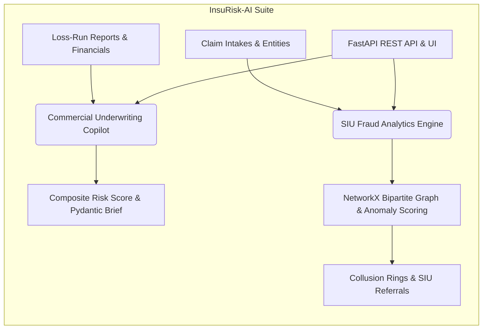

# InsuRisk-AI: Enterprise Underwriting Intake & Claim Fraud Analytics Suite

[](https://www.python.org/)
[](https://fastapi.tiangolo.com/)
[](https://networkx.org/)
[](https://pytest.org/)

An enterprise-grade, high-performance insurance technology platform featuring an automated **Commercial Underwriting Copilot** and a graph-based **SIU Claim Fraud Analytics Engine** powered by FastAPI, Pydantic, and NetworkX.

---

## 🏗️ System Architecture



---

## 🚀 Quickstart

1. **Clone & Navigate**:
   ```bash
   cd insurisk-ai-suite
   ```

2. **Install Dependencies**:
   ```bash
   pip install -r requirements.txt
   ```

3. **Run Test Suite**:
   ```bash
   python -m pytest -v
   ```

4. **Start the API Server**:
   ```bash
   uvicorn insurisk.api.app:app --reload --port 8000
   ```
   * Open [http://localhost:8000/docs](http://localhost:8000/docs) for interactive Swagger documentation.

---

## 📡 API Endpoints

| Endpoint | Method | Description |
| :--- | :--- | :--- |
| `/` | `GET` | Service overview & status dashboard |
| `/api/v1/underwrite/analyze` | `POST` | Commercial underwriting risk evaluation & pricing multiplier |
| `/api/v1/fraud/inspect-network` | `POST` | Graph-based collusion ring detection & multi-factor anomaly scoring |

---

## 💼 Resume & Portfolio Bullet Points

- **Engineered InsuRisk-AI**: Architected a commercial underwriting copilot and SIU fraud analytics suite in Python and FastAPI, processing multi-year loss runs and performing graph-based anomaly detection.
- **Advanced Graph Analytics**: Implemented multi-relational bipartite graph analysis using NetworkX to detect syndicated insurance fraud rings connecting claimants, medical providers, VINs, and addresses.
- **Enterprise-Grade Reliability**: Built robust Pydantic data validation pipelines with automated unit and API integration tests (`pytest`).
